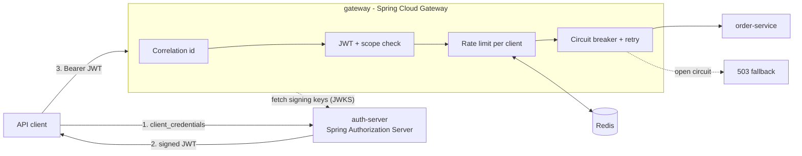

# api-gateway-auth

[](https://github.com/sameerkhanp119-dot/api-gateway-auth/actions/workflows/ci.yml)


The secure front door for a microservice platform. An **OAuth2 authorization server** issues signed JWTs,
and a reactive **API gateway** validates them, enforces per-route scopes, rate-limits each client,
and shields downstream services with circuit breakers and retries.

It is designed to sit in front of [commerce-order-platform](https://github.com/sameerkhanp119-dot/commerce-order-platform).

## Architecture



## What the gateway enforces

| Concern | How |
|---|---|
| **Authentication** | Every `/api/**` call needs a JWT signed by the auth server. Keys are fetched from `/oauth2/jwks` and cached, so the gateway never calls the auth server per request. |
| **Authorization** | Scopes map to routes and methods: `GET /api/v1/orders/**` needs `orders.read`; writes need `orders.write`. Rejected calls never reach a service. |
| **Fair usage** | Redis token-bucket rate limiting keyed by OAuth2 client (falls back to IP), so one noisy integration cannot starve the rest. Over-limit calls get `429`. |
| **Resilience** | Resilience4j circuit breaker opens after a 50% failure rate and returns a fast `503` problem response with `Retry-After`. Idempotent `GET`s are retried with exponential backoff; writes are never retried at the edge. |
| **Traceability** | An `X-Correlation-Id` is accepted or generated, forwarded downstream and echoed back to the caller. |
| **Operability** | Health probes, Prometheus metrics, and the gateway actuator for live route inspection. |

## OAuth2 clients

| Client | Scopes | Typical use |
|---|---|---|
| `order-portal` | `orders.read orders.write` | Customer-facing app that places and views orders |
| `reporting-job` | `orders.read` | Batch reporting; can read but never write |

Secrets are injected from environment variables (Kubernetes Secrets in the cluster); the local defaults are for demos only.

## Run it locally

```bash
docker compose up --build
```

This starts the auth server (`:9000`), the gateway (`:8080`), Redis, and a WireMock stand-in for order-service.

### 1. Get a token

```bash
TOKEN=$(curl -s -u order-portal:portal-secret \
  -d grant_type=client_credentials -d 'scope=orders.read orders.write' \
  localhost:9000/oauth2/token | jq -r .access_token)
```

### 2. Call through the gateway

```bash
curl -i -H "Authorization: Bearer $TOKEN" localhost:8080/api/v1/orders/42
# 200, plus an X-Correlation-Id header that the stub echoes in the body
```

### 3. See authorization at the edge

```bash
curl -i localhost:8080/api/v1/orders/42                       # 401: no token

READ_ONLY=$(curl -s -u reporting-job:reporting-secret \
  -d grant_type=client_credentials -d scope=orders.read \
  localhost:9000/oauth2/token | jq -r .access_token)
curl -i -X POST -H "Authorization: Bearer $READ_ONLY" localhost:8080/api/v1/orders   # 403: missing orders.write
```

### 4. Trip the rate limiter

```bash
for i in $(seq 1 30); do
  curl -s -o /dev/null -w "%{http_code} " -H "Authorization: Bearer $TOKEN" localhost:8080/api/v1/orders/42
done
# 200s, then 429s once the burst of 10 is spent
```

### 5. Watch the circuit breaker

```bash
docker compose stop orders-stub
curl -i -H "Authorization: Bearer $TOKEN" localhost:8080/api/v1/orders/42
# 503 problem+json with Retry-After: 5, returned by the fallback instead of hanging
```

## Tests

```bash
mvn verify
```

- **auth-server:** token issuance, scope restrictions per client, bad credentials, and JWKS publication.
- **gateway:** 401/403 scope rules, public health probes, correlation-id handling, and rate-limit key resolution.

## Kubernetes

`k8s/` contains Deployments, Services, PodDisruptionBudgets and an HPA (gateway scales 3–10 pods on CPU).
CI publishes `ghcr.io/sameerkhanp119-dot/auth-server` and `gateway` images on every push to `main`.

```bash
kubectl apply -f k8s/namespace.yaml
kubectl -n edge create secret generic oauth-clients \
  --from-literal=order-portal=... --from-literal=reporting-job=...
kubectl apply -f k8s/
```

## Design notes

- **Why validate at the gateway and in services?** The gateway rejects bad traffic early and cheaply; services should still validate tokens (defense in depth) because internal traffic can bypass the edge.
- **Why no retries on writes?** A retried `POST` after a timeout can create duplicates. Writes rely on the downstream idempotency key instead (see commerce-order-platform).
- **Why key rate limits by client, not IP?** Many clients share NAT/egress IPs; the token subject identifies the real integration.

## Roadmap

- Persist registered clients in PostgreSQL (`JdbcRegisteredClientRepository`) with an admin API
- Authorization-code + PKCE flow for a browser frontend
- Token relay with audience restriction per downstream service
- OpenTelemetry tracing across gateway and services

## License

MIT
